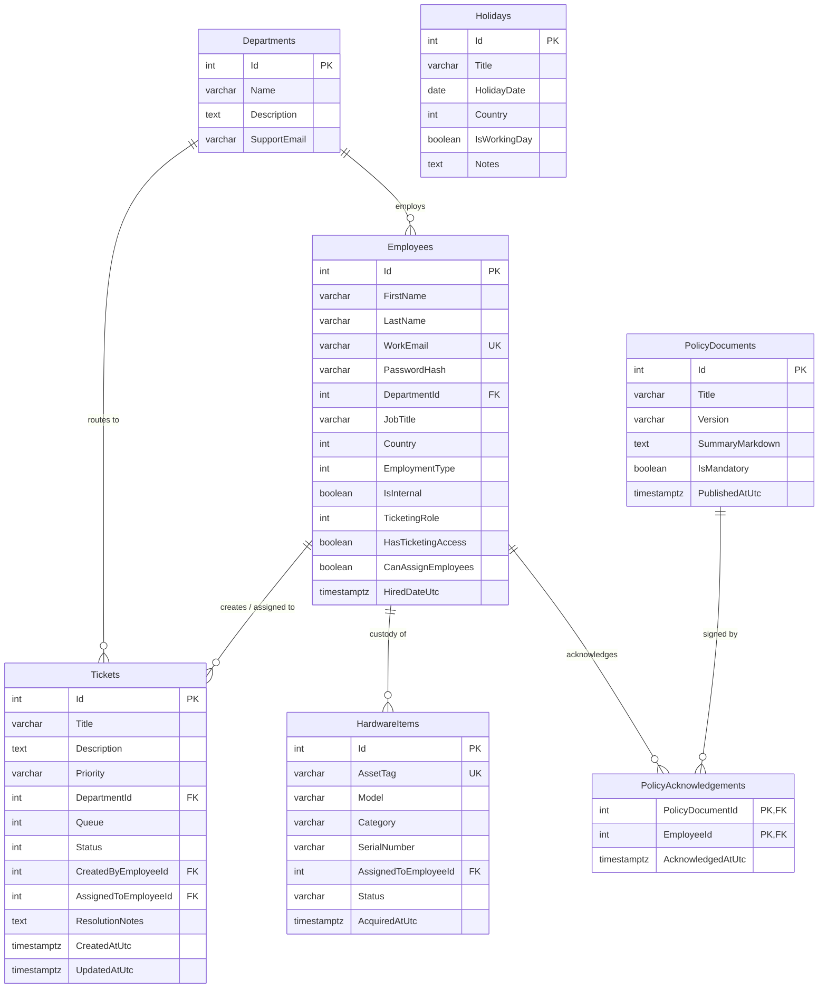

# Enterprise Employee Operations Hub — Technical Documentation

**Version:** 2.0  
**Target Environment:** Node.js Serverless (Vercel) / ASP.NET Core 8 / Vite React SPA / Supabase PostgreSQL  
**Last Updated:** October 2026  

---

## 1. System Architecture & Overview

The **Enterprise Employee Operations Hub** is an enterprise-grade workforce management, attendance tracking, and internal IT/HR service desk platform engineered for distributed and cross-border teams (specifically bridging operations between **Manila, Philippines (UTC+8)** and **Copenhagen, Denmark (UTC+1/UTC+2)**).

```
+-----------------------------------------------------------------------------------+
|                                  CLIENT LAYER                                     |
|  +-------------------------------------+  +------------------------------------+  |
|  |     apps/employee-portal (Vite)     |  |     apps/ticketing-desk (Vite)     |  |
|  |  * Time Clock & Dual World Clocks   |  |  * Kanban Board & Triage Queue     |  |
|  |  * Hardware Asset Inspection        |  |  * SLA Analytics & Workload Engine |  |
|  |  * Policy Compliance Sign-Off       |  |  * RBAC & User Permission Matrix   |  |
|  +-------------------------------------+  +------------------------------------+  |
+------------------------------------------+----------------------------------------+
                                           | HTTPS / JSON
                                           v
+-----------------------------------------------------------------------------------+
|                                 APPLICATION LAYER                                 |
|  +-----------------------------------------------------------------------------+  |
|  |                    Vercel Edge / Serverless Functions                       |  |
|  |  * api/_handler.js: Unified Router & Controller Logic                       |  |
|  |  * api/_db.js: PostgreSQL Pool Management & Connection Failover Recovery     |  |
|  |  * Inbound Email Ingestion & Department Routing Engine                      |  |
|  |  * PBKDF2 Password Verification & RBAC Authorization Gate                   |  |
|  +-----------------------------------------------------------------------------+  |
|  |               Alternative Local Host: ASP.NET Core 8 Web API                |  |
|  |  * backend/src/EmployeeHub.Api (Controllers, EF Core, DTOs, SQLite/Npgsql)  |  |
|  +-----------------------------------------------------------------------------+  |
+------------------------------------------+----------------------------------------+
                                           | Connection Pool (SSL / Port 5432)
                                           v
+-----------------------------------------------------------------------------------+
|                                   DATA LAYER                                      |
|  +-----------------------------------------------------------------------------+  |
|  |                 Supabase PostgreSQL 15+ (Schema: employee_hub)              |  |
|  |  * Employees                * Departments           * Tickets               |  |
|  |  * HardwareItems            * Holidays              * PolicyDocuments       |  |
|  |  * PolicyAcknowledgements   * AttendanceRecords     * TimeRequests          |  |
|  +-----------------------------------------------------------------------------+  |
+-----------------------------------------------------------------------------------+
```

### Key Architectural Tenets
1. **Hybrid Deployment Flexibility:**
   - **Production (Cloud/Vercel):** Frontend delivered as static React bundles through Vercel CDN; serverless REST endpoints implemented in ES modules backed by a shared Supabase PostgreSQL pool.
   - **Local / Containerized (Docker):** Full-stack orchestration via `docker-compose.yml` supporting ASP.NET Core 8 Web API, Vite dev servers, and persistent PostgreSQL/SQLite volumes.
2. **Resilient Connection Pool Management:**
   - Dedicated connection sanitizer (`api/_db.js`) detects line-wrap truncation on pooler hosts (e.g., `aws-0-`) and fails over gracefully to verified Supabase connection pools.
   - `safeInt` parameter parsing guarantees that malformed or `undefined` query parameters never trigger SQL type conversion errors (`22P02`).
3. **Data Isolation & Row-Level Access:**
   - Client-dedicated developers only query their own profiles and tickets.
   - Support agents and department heads access department-filtered queues.
   - Super Administrators retain unrestricted visibility across all departments and audit logs.

---

## 2. Database Schema & Data Models

All tables reside within the dedicated PostgreSQL schema `employee_hub`.

### 2.1 Entity Relationship Diagram



### 2.2 Table Definitions

#### `employee_hub."Employees"`
| Column | Type | Constraints | Description |
|---|---|---|---|
| `Id` | `SERIAL` | `PRIMARY KEY` | Unique employee identifier |
| `FirstName` | `VARCHAR(100)` | `NOT NULL` | Employee given name |
| `LastName` | `VARCHAR(100)` | `NOT NULL` | Employee family name |
| `WorkEmail` | `VARCHAR(255)` | `NOT NULL, UNIQUE` | Corporate authentication email |
| `PasswordHash` | `VARCHAR(500)` | `NOT NULL` | PBKDF2-hashed credential with salt |
| `DepartmentId` | `INT` | `REFERENCES Departments(Id)` | Primary departmental assignment |
| `JobTitle` | `VARCHAR(150)` | `NOT NULL` | Functional job title |
| `Country` | `INT` | `DEFAULT 1` | `1`: Philippines, `2`: Denmark |
| `EmploymentType` | `INT` | `DEFAULT 1` | `1`: FullTime, `2`: PartTime, `3`: Contractor |
| `IsInternal` | `BOOLEAN` | `DEFAULT FALSE` | Internal operational staff vs client dedicated |
| `TicketingRole` | `INT` | `DEFAULT 0` | `0`: Employee, `1`: SuperAdmin, `2`: Admin, `3`: Agent |
| `HasTicketingAccess` | `BOOLEAN` | `DEFAULT FALSE` | Permission to access Service Desk application |
| `CanAssignEmployees` | `BOOLEAN` | `DEFAULT FALSE` | Privilege to allocate tickets to specialists |
| `HiredDateUtc` | `TIMESTAMPTZ` | `DEFAULT NOW()` | Date of corporate onboarding |

#### `employee_hub."Tickets"`
| Column | Type | Constraints | Description |
|---|---|---|---|
| `Id` | `SERIAL` | `PRIMARY KEY` | Auto-incrementing ticket ID |
| `Title` | `VARCHAR(255)` | `NOT NULL` | Subject summary of request |
| `Description` | `TEXT` | `NOT NULL` | Detailed incident or request notes |
| `Priority` | `VARCHAR(50)` | `DEFAULT 'Medium'` | `'Low'`, `'Medium'`, `'High'`, `'Critical'` |
| `DepartmentId` | `INT` | `REFERENCES Departments(Id)` | Routing target department |
| `Queue` | `INT` | `DEFAULT 1` | `1`: CustomerSupport, `2`: TechnicalSupport, `3`: Billing, `4`: HR |
| `Status` | `INT` | `DEFAULT 1` | `1`: Open, `2`: InProgress, `3`: Resolved, `4`: Closed |
| `CreatedByEmployeeId`| `INT` | `REFERENCES Employees(Id)` | Submitter employee identity |
| `AssignedToEmployeeId`| `INT` | `REFERENCES Employees(Id)` | Designated resolver identity |
| `ResolutionNotes` | `TEXT` | `NULL` | Post-resolution diagnostic notes |
| `CreatedAtUtc` | `TIMESTAMPTZ` | `DEFAULT NOW()` | Submission timestamp |
| `UpdatedAtUtc` | `TIMESTAMPTZ` | `DEFAULT NOW()` | Last modification timestamp |

---

## 3. REST API Specification

### Authentication & Identity Endpoints

#### `POST /api/auth/login`
Authenticates user credentials and verifies PBKDF2 hash.
- **Request Body:**
  ```json
  {
    "email": "gamboa.khinandrei@gmail.com",
    "password": "Password123!"
  }
  ```
- **Response (200 OK):**
  ```json
  {
    "id": 1,
    "firstName": "Khin Andrei",
    "lastName": "Gamboa",
    "workEmail": "gamboa.khinandrei@gmail.com",
    "jobTitle": "DevOps Engineer & Super Admin",
    "country": "Philippines",
    "isInternal": true,
    "ticketingRole": 1,
    "roleName": "SuperAdmin",
    "hasTicketingAccess": true,
    "canAssignEmployees": true
  }
  ```

#### `GET /api/auth/personas`
Retrieves pre-configured 1-click test personas for rapid role evaluation across SuperAdmin, Admin, Agent, and Employee levels.

---

### Ticket Operations Endpoints

#### `GET /api/tickets`
Retrieves tickets filtered by caller privileges, status, or creator.
- **Query Parameters:**
  - `callerEmployeeId` (int, optional): Authenticated caller identity for data isolation.
  - `createdByEmployeeId` (int, optional): Filter by ticket author.
  - `departmentId` (int, optional): Filter by receiving department.
  - `status` (string/int, optional): `Open`, `InProgress`, `Resolved`, `Closed`.
  - `queue` (string/int, optional): `CustomerSupport`, `TechnicalSupport`, `Billing`, `HR`.
- **Response (200 OK):** Array of Ticket objects with joined department and employee names.

#### `POST /api/tickets`
Creates an operational ticket.
- **Request Body:**
  ```json
  {
    "title": "VPN Profile Refresh Needed",
    "description": "Unable to connect to Danish staging cluster after subnet update.",
    "priority": "High",
    "departmentId": 1,
    "queue": 2,
    "createdByEmployeeId": 6
  }
  ```

#### `PATCH /api/tickets/:id/status`
Updates operational lifecycle status and logs resolution notes.
- **Request Body:**
  ```json
  {
    "status": "Resolved",
    "assignedToEmployeeId": 1,
    "resolutionNotes": "Regenerated WireGuard configuration profile; DNS resolving cleanly."
  }
  ```

#### `POST /api/tickets/inbound-email`
Simulates auto-ingestion of support emails into parsed operational tickets.
- **Request Body:**
  ```json
  {
    "fromEmail": "dev.arnel@company.io",
    "toDepartmentEmail": "it-support@malayo.com",
    "subject": "Request for external 4K monitor",
    "bodyText": "Need external display for frontend responsive testing.",
    "priority": "Medium"
  }
  ```

---

### Hardware Inventory Endpoints

#### `GET /api/hardware`
Lists corporate hardware assets with current employee custody tags and serials.
- **Response (200 OK):**
  ```json
  [
    {
      "id": 1,
      "assetTag": "HW-MBP-001",
      "model": "Apple MacBook Pro 16\" M3 Max",
      "category": "Laptop",
      "serialNumber": "C02G80XYZ99",
      "assignedToEmployeeId": 6,
      "assignedToName": "Arnel Santos",
      "status": "Active",
      "acquiredAtUtc": "2026-01-15T08:00:00.000Z"
    }
  ]
  ```

---

### Policy Compliance & Digital Sign-Off Endpoints

#### `GET /api/policies`
Returns corporate policies with digital signature status for a specified employee.
- **Query Parameters:** `employeeId` (int, optional)
- **Response (200 OK):**
  ```json
  [
    {
      "id": 1,
      "title": "Information Security & ISO 27001 Code of Conduct",
      "version": "2.4",
      "summaryMarkdown": "Mandatory guidelines regarding credential storage and MFA.",
      "isMandatory": true,
      "publishedAtUtc": "2026-01-01T00:00:00.000Z",
      "totalAcknowledgements": 14,
      "isAcknowledgedByCurrentEmployee": true
    }
  ]
  ```

#### `POST /api/policies/:id/acknowledge`
Records immutable compliance acknowledgement timestamp.
- **Request Body:**
  ```json
  {
    "employeeId": 6
  }
  ```

---

## 4. Security & Access Control (RBAC)

### 4.1 Role Hierarchy

| Role Level | Numeric Enum | Scope of Access | Typical Title |
|---|---|---|---|
| **SuperAdmin** | `1` | Universal read/write across all queues, audit logs, employee access overrides | Head of DevOps / CTO |
| **Admin** | `2` | Full department triage, ticket re-assignment, department inbox management | IT Lead / HR Manager |
| **Agent** | `3` | View assigned department tickets, update status, submit resolution notes | Support Specialist |
| **Employee** | `0` | Restricted to own profile, personal attendance, submitted tickets, hardware custody | Client Developer / Staff |

### 4.2 Credential Protection
Passwords are encrypted using PBKDF2 with SHA-256:
- **Salt:** 16 cryptographically random bytes generated via Node.js `crypto.randomBytes`.
- **Iterations:** 10,000 rounds.
- **Key Length:** 32 bytes (256 bits).
- **Storage Format:** `{iterations}:{saltHex}:{hashHex}`.

---

## 5. Deployment & Infrastructure Setup

### 5.1 Environment Variables Matrix

| Variable Name | Required By | Environment | Description |
|---|---|---|---|
| `SUPABASE_DB_URL` | Serverless API | Vercel (Production) | Pooled PostgreSQL connection string (`Transaction` mode, port 5432) |
| `DATABASE_URL` | Serverless API | Vercel (Production) | Fallback database connection string |
| `VITE_API_BASE_URL` | Frontend Client | Development / Preview | Explicit backend URL (defaults to relative `'/api'` in production) |
| `VITE_TICKETING_URL`| Employee Portal | Client Linkage | Canonical URL of Service Desk app |
| `VITE_PORTAL_URL` | Service Desk | Client Linkage | Canonical URL of Employee Portal app |

### 5.2 Vercel Monorepo Rewrites Configuration
```json
{
  "$schema": "https://openapi.vercel.sh/vercel.json",
  "rewrites": [
    {
      "source": "/api",
      "destination": "/api/index.js"
    },
    {
      "source": "/api/(.*)",
      "destination": "/api/index.js"
    },
    {
      "source": "/((?!api/).*)",
      "destination": "/index.html"
    }
  ]
}
```

---

## 6. Operational Troubleshooting & Runbook

| Incident | Root Cause | Automated Resolution |
|---|---|---|
| `getaddrinfo ENOTFOUND aws-0-` | Line-wrapped terminal copy pasted into Vercel env variable | `api/_db.js` `sanitizeConnStr()` detects partial hostname and routes to `DEFAULT_SUPABASE_URL` |
| `invalid input syntax for type integer: "NaN"` | Query parameter received `'undefined'` or empty string | `safeInt()` safely returns `null` or default value instead of `NaN` |
| `Error loading tickets: Failed to fetch` | Client attempted to fetch cross-origin placeholder domain | `client.js` `getApiBase()` forces relative `'/api'` for any non-localhost origin |
